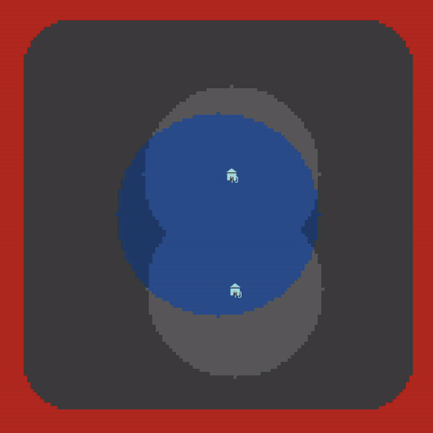
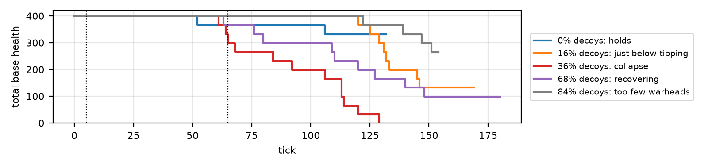

# Decoy saturation: a tipping-point agent-based model

An agent-based NetLogo model of how cheap distractors can exhaust a limited, slowly refilling resource, and why the result is an abrupt collapse rather than a gradual decline.



*Red = armed drone, yellow = decoy, blue = interceptor. The lower base spends its interceptors on decoys, and then an armed drone gets through. ([Full-quality video](presentation/demo.mp4))*

## The story

The setting: *Sociodynamics of Emutopia and Kiwiland relations*. Emutopia keeps sending "airborne humanitarian food deliveries" to Kiwiland, which would rather not receive them. Each wave has a fixed budget. An armed drone costs 100, while a decoy costs 15 and does nothing. Kiwiland's bases fire interceptors at whatever drone they pick out on radar, and each base holds only a few interceptors, which reload slowly.

**Research question:** how do the decoy share of the budget and the defender's ability to recognise decoys decide whether the defence holds?

## Result


- **The system does not degrade gradually; it tips.**
  - At 20% decoy recognition, losses jump from 0.56 bases with no decoys to 3.54 of 4 at 30% decoys.
  - The tipping point is **22.6% of the budget spent on decoys**, or about 1.8 decoys per armed drone.
- **Better recognition moves the tipping point up:** it is 18.8% at 0% recognition and 26.5% at 30% recognition. From 40% recognition the defence never collapses.
- **Almost pure decoy swarms are harmless again:** too few armed drones remain. From 78% decoys upward, losses stay below 0.5 bases.



Every setting was run 100 times (56,100 runs in the main sweep). The 95% confidence intervals are at most ±0.36 bases. The full two-page write-up is in the [report](latex/documentation.pdf).

## Beyond the story

The mechanism is general: a capacity-limited responder that cannot tell cheap noise from real demand. Once the noise is large enough to use up the capacity, the system tips. The same structure appears in:

- **Network security:** DDoS floods that bury legitimate requests.
- **Security operations:** alert fatigue, where analysts drown in false positives and miss the real incident.
- **Healthcare:** triage under mass casualties, where minor cases take up scarce staff.
- **Biology:** pathogens that shed decoy antigens to soak up antibodies.

In every case the same two levers matter: what share of the input is noise, and how well the responder can filter it.

## Model

- **Bases** (default 4) sit in a central homeland. Each holds 10 interceptors and reloads 1 every 4 ticks.
- **Drones** launch in waves from a ring around the homeland and fly straight at their assigned base. Each wave is split evenly over the bases.
- **Interceptors** each chase one drone and roll once for a hit (85%). An interceptor is used up after one attempt.
- **Decoy recognition:** with this probability, a base aims at the nearest *armed* drone. Otherwise it aims at the nearest drone of either kind.
- **Weather:** random rain showers lower the hit chance.

## Files

| File | Contents |
|---|---|
| `decoy_saturation.nlogox` | The model (NetLogo 7.0.4); the Info tab explains it |
| `decoy_saturation_experiment.xml` | BehaviorSpace experiments: main sweep, time series, decoys-per-drone sweep |
| `run_experiments.py` | Runs an experiment headless |
| `make_figures.py` | Statistics (mean, 95% CI) and the figures |
| `sweep_results.csv`, `timeseries.csv`, `ratio_sweep.csv` | Raw BehaviorSpace output |
| `summary_table_ci.csv` | Mean and 95% CI for each of the 561 settings |
| `latex/` | Report source, PDF and figures |

## Reproduce

1. Open `decoy_saturation.nlogox` in [NetLogo 7.0.4](https://ccl.northwestern.edu/netlogo/), then press `setup` and `go`.
2. Re-run the experiments headless. If NetLogo isn't in its default Windows location, change the NetLogo paths in `run_experiments.py`.
   ```bash
   python run_experiments.py                                   # decoy-saturation-sweep -> sweep_results.csv (56,100 runs)
   python run_experiments.py regime-timeseries timeseries.csv
   ```
3. Rebuild the statistics and figures:
   ```bash
   pip install -r requirements.txt
   python make_figures.py
   ```

## Scope and limitations

This is an abstract educational model. It uses no real-world system data and does not try to represent any real system.

- Drones fly straight.
- Both sides follow simple fixed tactics, and neither adapts.
- Bases do not share interceptors.
- Costs and magazine sizes are stylised. The exact percentages are not real-world numbers. The result is the shape of the transition.
- and much much more

## Acknowledgements

Made for Assignment 1 of *Collective Intelligence* at ELTE Faculty of Informatics. Inspired by Perun's YouTube presentations.

## License

[MIT](LICENSE)
