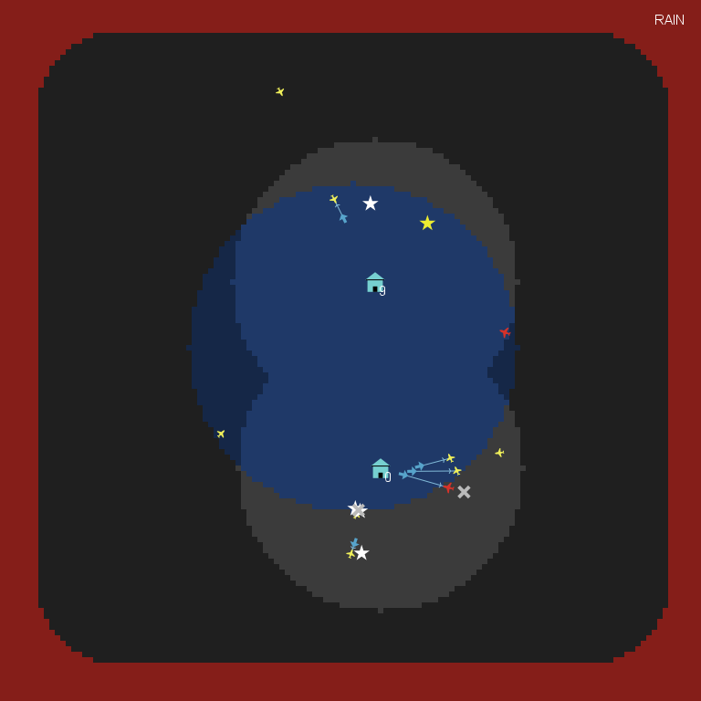
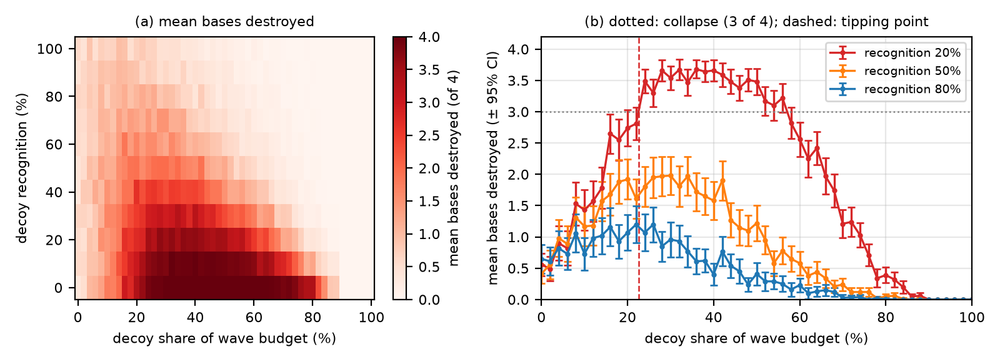

# Sociodynamics of Emutopia and Kiwiland relations

An agent-based NetLogo model of **decoy saturation**: how cheap decoy drones can empty an air defence's magazines so that the armed drones get through.
Made for Assignment 1 of *Collective Intelligence* (ELTE IK).

Emutopia keeps sending "airborne humanitarian food deliveries" to Kiwiland, which would rather not receive them. Every attack wave has a fixed budget. Each lethal drone costs 100, and each decoy costs 15 and does no damage. Kiwiland's bases launch interceptors at whatever drone they pick out on radar.

**Research question:** how do the decoy share of the attack budget and the defender's ability to recognise decoys decide whether the defence holds?

[](presentation/demo.mp4)

*Demo (click to open): red = lethal drone, yellow = decoy, blue = interceptor.*

## Result



- **The defence does not degrade gradually; it collapses.**
  - At 20% decoy recognition, losses jump from 0.56 bases without decoys to 3.54 of 4 at 30% decoys.
  - The tipping point is **22.6% of the budget spent on decoys**, or about 1.8 decoys per armed drone.
- **Better recognition moves the tipping point up:** it is 18.8% at 0% recognition and 26.5% at 30%. From 40% recognition the defence never collapses.
- **Almost pure decoy swarms are harmless again:** they carry too few warheads, and from 78% decoys the losses stay below 0.5 bases.

Every setting was run 100 times. The 95% confidence intervals are at most ±0.36 bases. The full write-up is in the [report](latex/documentation.pdf), and the slides are in the [presentation](presentation/presentation.pdf).

## Model

- **Bases** (default 4) sit in a central homeland. Each has 10 interceptors and reloads 1 every 4 ticks.
- **Drones** launch in waves from a ring around the homeland. They fly straight at the base assigned to them, and each wave is split evenly over the bases.
- **Interceptors** chase one drone and roll for a kill (85%). Each is used up after one attempt.
- **Decoy recognition:** with this probability a base aims at the nearest *lethal* drone; otherwise it aims at the nearest drone of any kind.
- **Weather:** random rain showers lower the kill chance.

## Files

| File | Contents |
|---|---|
| `decoy_saturation.nlogox` | The model (NetLogo 7.0.4); the Info tab explains it |
| `decoy_saturation_experiment.xml` | BehaviorSpace experiments: the main sweep, the time series, the decoys-per-drone sweep |
| `run_experiments.py` | Runs an experiment headless |
| `make_figures.py` | Statistics (mean, 95% CI) and the report figures |
| `sweep_results.csv`, `timeseries.csv`, `ratio_sweep.csv` | Raw BehaviorSpace output |
| `summary_table_ci.csv` | Mean and 95% CI for each of the 561 settings |
| `latex/` | Report source, PDF and figures |
| `presentation/` | Slides (`.pptx`, `.pdf`) and the demo video |

## Reproduce

1. Open `decoy_saturation.nlogox` in [NetLogo 7.0.4](https://ccl.northwestern.edu/netlogo/), then press `setup` and `go`.
2. Re-run the experiments headless. In `run_experiments.py`, change the NetLogo paths if NetLogo isn't in its default Windows location.
   ```bash
   python run_experiments.py                                   # decoy-saturation-sweep -> sweep_results.csv (56,100 runs)
   python run_experiments.py regime-timeseries timeseries.csv
   ```
3. Rebuild the statistics and figures (needs `matplotlib`):
   ```bash
   python make_figures.py
   ```

## Limitations

- Drones fly straight.
- Both sides follow simple fixed tactics, and neither adapts.
- The bases do not share interceptors.
- Costs and magazine sizes are stylised. The exact percentages are not real-world numbers, but the shape of the transition is the result.
